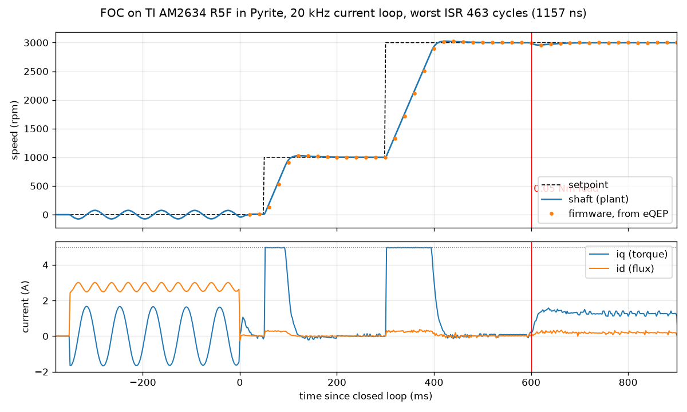

# foc-motor-am263x

Field-oriented control of a three-phase PMSM on a TI Sitara **AM2634** (Arm Cortex-R5F, 400 MHz),
built with TI's MCU+ SDK and tested on every commit in simulation with [Pyrite](https://simantic.com),
Simantic's firmware simulator. No board or motor is needed to build, run or test it.

- **The firmware** (`fw/foc.c`, NORTOS, TI driverlib): ePWM0/1/2 generate 20 kHz centre-aligned
  three-phase PWM; ePWM0 SOCA triggers ADC1 to sample both phase shunts at the centre of the
  low-side window; ADC1 INT1 (through INTXBAR) runs the 20 kHz current loop (Clarke, Park, PI on
  id and iq, inverse Park, SVPWM); a 1 kHz speed loop closes on eQEP1, a 500-line encoder. At boot
  it calibrates the current-sense offsets and aligns the rotor to find the encoder zero.
- **The simulation** (`sim/`): the firmware binary runs unmodified on the simulated AM2634.
  `plant.py` is a PMSM (R 0.2 Ohm, L 100 uH, 7 pole pairs, 24 V bus) that reads the ePWM compare
  registers and drives the ADC pins; `encoder.py` turns the shaft angle into eQEP A/B edges.
  The plant adds a 0.05 Nm load at 1.0 s.
- **The tests** (`tests/`): pytest runs the scenario against five motors and checks the drive's
  step response, load rejection, limits and timing against the plant's true shaft.



Speed steps 0 -> 1000 -> 3000 rpm, then a 0.05 Nm load. Before t = 0 the drive calibrates its
current sense and aligns the rotor (the ringing on the d axis). The orange dots are the firmware's
own speed, from eQEP; the blue line is the plant's true shaft. `tools/plot.py` regenerates it.

## Run it

```sh
make -C fw PROFILE=release MCU_PLUS_SDK_PATH=... CGT_TI_ARM_CLANG_PATH=... \
     SYSCFG_PATH=... SYSCFG_CLI_PATH=... foc.release.out   # run twice on a clean tree (SysConfig ordering)
sim run --scenario sim/motor.yaml --ascii --timeout 1.5
```

Needs TI MCU+ SDK for AM263x 26.00.00.06, TI Arm Clang 5.1.1 and SysConfig.

## Test it

```sh
pip install pytest && pytest tests -v     # SIM=<path> picks a sim binary, about 30 s
```

Every test runs against five motors with the same firmware. The gains are tuned for `nominal`;
the others catch a drive that only works on the motor it was tuned on.

| Motor | Change |
| --- | --- |
| `nominal` | R 0.2 Ohm, L 100 uH, J 1e-4 kg m^2, 24 V bus |
| `hot_winding_R+50%` | R 0.3 Ohm |
| `L+50%` | L 150 uH |
| `heavy_load_J_x2` | J 2e-4 kg m^2 |
| `bus_sag_20V` | 20 V bus (the firmware still assumes 24 V) |

| Test | Checks (on the plant's true shaft unless noted) |
| --- | --- |
| `test_boots_and_reports_pass` | the firmware's own verdict |
| `test_current_sense_offsets_are_midscale` | ADC offset calibration |
| `test_encoder_alignment_is_field_oriented` | under load the current vector is within 15 deg of the q axis (a wrong encoder zero fails this) |
| `test_rise_time_0_to_1000_rpm` | 10-90% within 25% of the current-limited minimum J dw / (Kt Imax) |
| `test_overshoot_1000_rpm`, `test_overshoot_3000_rpm` | under 10% and 5% (integrator windup fails this) |
| `test_settles_at_1000_rpm`, `test_settles_at_3000_rpm` | within 2% after 120 ms and 250 ms |
| `test_load_step_dip`, `test_load_step_recovery` | the 0.05 Nm load costs under 5% and is recovered within 80 ms |
| `test_load_torque_is_carried_by_iq` | iq settles at load / Kt |
| `test_current_limit_is_respected` | iq never exceeds the 5 A limit |
| `test_firmware_speed_matches_the_shaft` | the firmware's eQEP speed against the true speed |
| `test_isr_fits_the_pwm_period` | current loop under 10% of the 50 us period (simulated cycle count) |

Known: with `heavy_load_J_x2` the fixed speed gains settle the 1000 rpm step in ~280 ms instead
of ~150 ms, so two tests are strict expected failures there. Gain scheduling would make them pass,
and pytest would then flag the marker for removal.

The tests caught one real bug while they were written: the speed PI wound up its integrator
during current-limited steps (17% overshoot). `pi_run` now integrates only when unsaturated.

## Limits

- Simulated only: not yet run on an AM263x LaunchPad and motor. Cycle counts are the simulator's
  estimate, not a silicon measurement.
- The plant averages switching (no ripple, no dead time) and the sensors are ideal.
- Needs a `sim` build with the AM263x ADC volts input and ePWM peek (pyrite PR);
  the released 0.10.2 does not have them.
